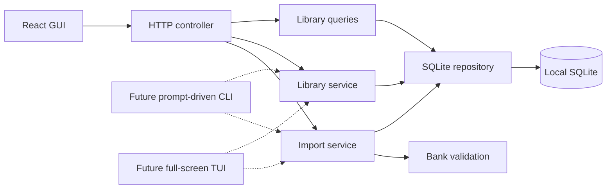

# Initial architecture

The application runs locally. A single loopback HTTP server serves the React
frontend and the API. SQLite is a local file. Only the GUI is implemented.

- `src/server/importer/` owns JSON validation, import previews, change review,
  and duplicate comparisons. The service receives parsed content, not paths.
- `src/server/questions/` owns library queries, deletion, and persistence. SQL
  and initial schema creation live in the repository; services own transactions.
- `src/server/http-controller.ts` translates HTTP requests into service calls.
  It enforces local host/origin access and request limits.
- `src/server/main.ts` owns startup, the database connection, and frontend serving.
- `src/web/` owns React presentation, file selection, and confirmation dialogs.
- `src/shared/` contains TypeScript request/result types used across boundaries.

Previewing does not write to SQLite. Confirmation validates again inside a
transaction and rejects a stale preview if the database or input changed.
Database revisions also change after deletion, invalidating outstanding previews.
Imports never remove questions absent from the incoming file.

This is intentionally a concrete SQLite implementation, with no repository
interface or generic database framework yet. Future terminal interfaces can use
the services without starting HTTP. Future database changes need versioned
migrations and tests; a switch of database engines is not implemented.

The initial library query loads the local collection to filter and paginate
25 records at a time. This is suitable for the current small banks; SQL-side
search and pagination can follow if measured size or latency requires them.

## Quiz services

`src/server/quizzes/` owns domain mapping, weighted selection, timed quiz use
cases, and quiz persistence. The library repository owns the shared SQLite
connection and exposes a quiz store; quiz writes use separate transactions
without invalidating library import revisions. Schema version 2 adds quiz and
mastery tables transactionally. Snapshots preserve completed results across
source edits/deletions. React and HTTP use public DTOs without answer keys until
completion. See [quiz rules](quizzes.md).

## Terms

- **GUI:** React web frontend.
- **TUI:** full-screen terminal UI, such as a DOS application or Neovim.
- **CLI:** interactive prompt-driven terminal workflow, such as a Bash wizard.
- **Application core:** validation and application services that do not depend on
  React or HTTP. SQLite access is isolated in the repository.
- **Source occurrence:** one question belonging to one source. Identical questions
  in other sources remain separate stored occurrences.
- **Preview:** proposed import changes, with a token binding the input to the
  current database revision. A preview is not a saved import.

No external hosting or runtime integrations are configured. No independent
review has been performed for this bootstrap.

## Reporting

`src/server/reports/report-service.ts` calculates reports from completed quiz
snapshots through the existing quiz repository. `GET /api/reports` validates
practice mode, provider/certification scope and rolling time filters, scores expired
sessions through the quiz service, and returns aggregate counts, UTC daily
activity, domain/topic/confidence breakdowns and attempt summaries. It omits
internal answer keys and fingerprints. Individual review uses the existing
completed quiz endpoint. No schema change or new dependency is required.

`ReportsPage` owns request cancellation and filter state. `ReportDashboard`
presents the aggregate evidence, and `ReportAttemptReview` presents saved
question-level results. `report-state.ts` defines the time-axis geometry and
plots daily correct/total scores, including all-skipped zeroes, and keeps cumulative
correct-answer activity separate. Days without questions have no measured score. Shared Markdown exporters
produce local downloadable artifacts.

## Reviewed concepts

`src/server/concepts/` owns local label suggestions, reviewed metadata, atomic
membership validation, and completed-snapshot variation recency. Bank content and
individual mastery remain separate. Normal quiz/exam selection preserves the
weighted draw's priority tier and domain while preferring eligible reviewed
variations. Due Review retains its actual due identities. Attempt snapshots save
concept labels for historical reporting. See [reviewed concept groups](concepts.md)
for the UI, migration, HTTP contracts and verification workflow.
