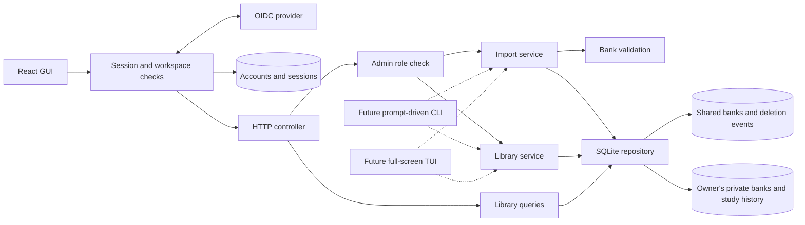

# Application architecture

One Node HTTP server serves React and the API. The default deployment is local;
remote origins require HTTPS. One SQLite database holds shared bank content; each
user has a separate file for private banks and study records. Another database
holds identities and hashed application sessions.

- `src/server/importer/` owns JSON validation, import previews, change review,
  and duplicate comparisons. The service receives parsed content, not paths.
- `src/server/questions/` owns library queries, deletion, and persistence. SQL
  and initial schema creation live in the repository; services own transactions.
- `src/server/auth/` verifies OIDC identity and role claims, manages opaque
  sessions, and binds admitted requests to an application account.
- `src/server/http-controller.ts` translates authenticated requests into service
  calls. It enforces origin, request-size, and shared-content role checks.
- `src/server/main.ts` owns startup, the database connection, and frontend serving.
- `src/web/` owns React presentation, file selection, and confirmation dialogs.
- `src/shared/` contains TypeScript request/result types used across boundaries.

Previewing does not write to SQLite. Its short-lived, single-use HTTP review
ticket belongs to one account. Confirmation validates again inside a
transaction and rejects a stale preview if the database or input changed.
Database revisions also change after deletion, invalidating outstanding previews.
Imports never remove questions absent from the incoming file.

This is intentionally a concrete SQLite implementation, with no repository
interface or generic database framework yet. Future terminal interfaces can use
the services without starting HTTP. Future database changes need versioned
migrations and tests; a switch of database engines is not implemented.

The initial library query loads the local collection to filter and paginate
25 records at a time. This is suitable for the current small banks; SQL-side
search and pagination can follow if measured size or latency requires them.

## Quiz services

`src/server/quizzes/` owns domain mapping, weighted selection, timed quiz use
cases, and quiz persistence. The combined study view reads both authorized
libraries and exposes the owner's private quiz store; quiz writes use separate transactions
without invalidating library import revisions. Schema version 2 adds quiz and
mastery tables transactionally; version 3 adds explicit study ownership and version
4 adds durable deletion events for the separate private files. Snapshots preserve completed results across
source edits/deletions. React and HTTP use public DTOs without answer keys until
completion. See [quiz rules](quizzes.md).

## Account and role boundaries

The server derives account ID and role from a verified application session, then
opens that account's owner-verified private database and creates a combined study
view over shared and private content. Study records stay in the private file;
queries retain their account binding as defense in depth.
Composite keys also isolate deliberately colliding record IDs. Admins receive
shared-content mutation permissions, not another user's study history.

Sources, questions, reviewed concept groups, and concept-suggestion moderation
are local to their owning library. Shared-bank deletion records a durable event
in the content transaction; each private file reconciles events before its next
read. Private-bank deletion and its snapshot annotations share one transaction.
Expiry and retention jobs visit owner-verified private stores. See
[private libraries](private-libraries.md) for migration and backup requirements.

The browser's account binding detects stale tabs; it does not select the server's
account. React replaces the workspace client when account or role changes, and
obsolete clients cannot dispatch through their replacements. Existing history is
attributed only through an explicit upgrade mapping. See
[authentication and rollout](authentication.md) for claims and revocation limits.

## Terms

- **GUI:** React web frontend.
- **TUI:** full-screen terminal UI, such as a DOS application or Neovim.
- **CLI:** interactive prompt-driven terminal workflow, such as a Bash wizard.
- **Application core:** validation and application services that do not depend on
  React or HTTP. SQLite access is isolated in the repository.
- **Source occurrence:** one question belonging to one source. Identical questions
  in other sources remain separate stored occurrences.
- **Preview:** proposed import changes, with a token binding the input to the
  current database revision. A preview is not a saved import.

OIDC is the configured external runtime integration. Question content and study
history remain in the application database and are not sent to the provider.

## Reporting

`src/server/reports/report-service.ts` calculates reports from completed quiz
snapshots through the existing quiz repository. `GET /api/reports` validates
practice mode, provider/certification scope and rolling time filters, scores expired
sessions through the quiz service, and returns aggregate counts, UTC daily
activity, domain/topic/confidence breakdowns and attempt summaries. It omits
internal answer keys and fingerprints. Individual review uses the existing
completed quiz endpoint. No schema change or new dependency is required.

`ReportsPage` owns request cancellation and filter state. `ReportDashboard`
presents the aggregate evidence, and `ReportAttemptReview` presents saved
question-level results. `report-state.ts` defines the time-axis geometry and
plots daily correct/total scores, including all-skipped zeroes, and keeps cumulative
correct-answer activity separate. Days without questions have no measured score. Shared Markdown exporters
produce local downloadable artifacts.

## Reviewed concepts

`src/server/concepts/` owns local label suggestions, reviewed metadata, atomic
membership validation, and completed-snapshot variation recency. Bank content and
individual mastery remain separate. Normal quiz/exam selection preserves the
weighted draw's priority tier and domain while preferring eligible reviewed
variations. Due Review retains its actual due identities. Attempt snapshots save
concept labels for historical reporting. See [reviewed concept groups](concepts.md)
for the UI, migration, HTTP contracts and verification workflow.

## Shared icons

`src/web/shared/ui/icons/` contains the standalone SVG artwork used by `StudyIcon`.
Vite's `?raw` imports bundle these files into JavaScript at build time; the component
renders the bundled markup inline, without fetching icons at runtime. Only trusted,
repository-owned SVG files belong in this registry; never pass imported question-bank
content or other user-supplied markup to it. SVG strokes use `currentColor`, and the
shared wrapper controls size so navigation and action icons follow their theme.
The quiz and practice destinations share the same artwork. Existing artwork is
preserved by this extraction; it is not attributed to an external icon set.
